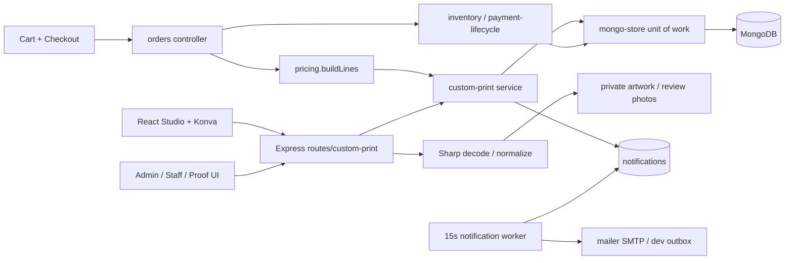
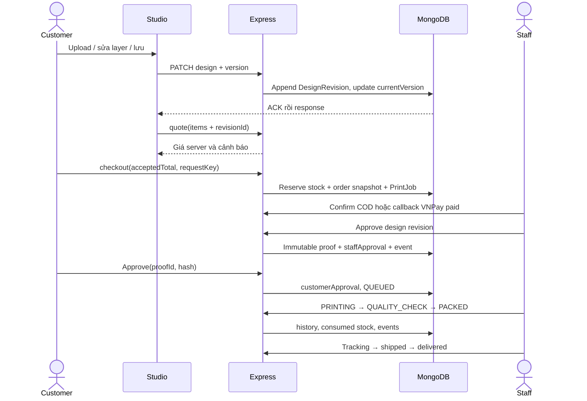
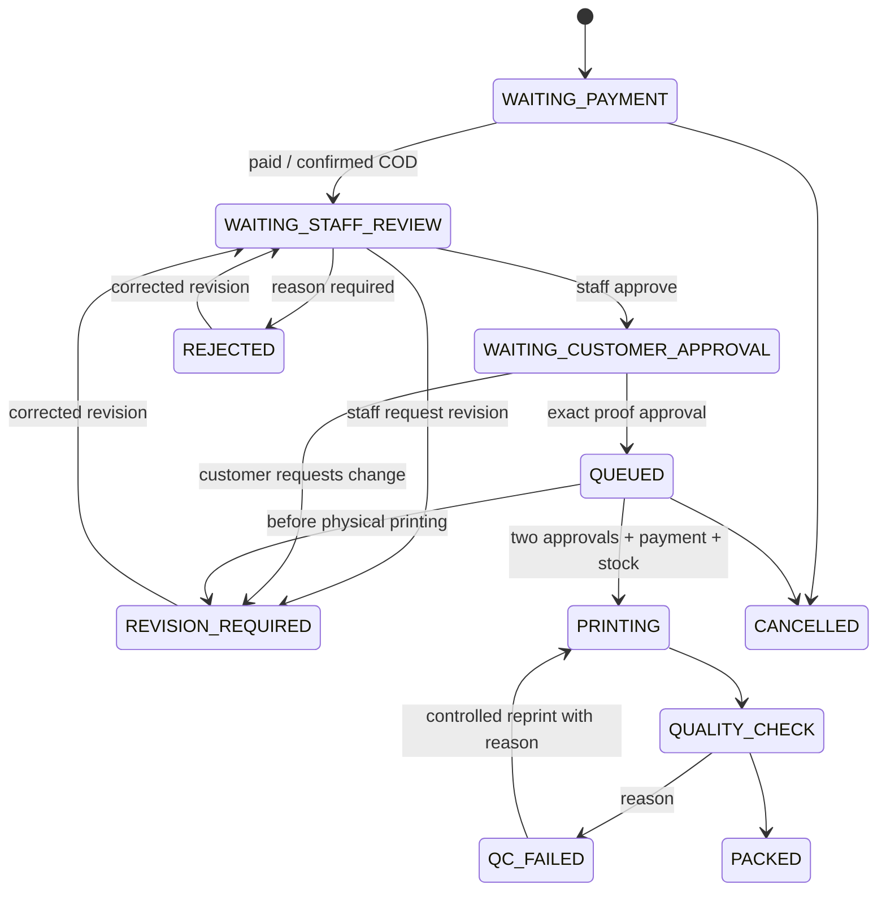

# Kiến trúc triển khai

> Bản mô tả nền ban đầu. V2 đã bổ sung transaction đọc–ghi replica set, targeted checkout/catalog, outbox worker và private raster/S3; xem [bản cập nhật kiến trúc](VELATHIER_V2_REMEDIATION.md) trước khi triển khai.

## Thành phần
Tái sử dụng Express/React/Mongoose, không thêm service độc lập. `custom-print.js` tập trung validation, geometry, quote extensions, approval gates, state machine và notification events. Controller cũ gọi các guards ngay trước thay đổi kho/trạng thái.

## Trình tự mua và duyệt

## Phân tách trạng thái

Hủy ở trạng thái khác được service guard kiểm tra. Admin ngoại lệ sau in cũng kết thúc CANCELLED; hàng đã tiêu hao không restock. Order shipping/payment/refund giữ state machine riêng.

## Lưu trữ và concurrency
- Models được đăng ký trong `server/models/index.js`; mongo-store tự đọc/lưu tất cả collections. Không tạo cache JSON mới.
- Business ID cũ được giữ. New lineId không thay đổi lịch sử cũ; thiếu itemType được coi regular.
- Optimistic version trên draft/config; unique indexes revision/version, settings/version, order user/requestKey, PrintJob line, review line, eventKey.
- Hàng đợi unit-of-work bảo vệ start printing/cancel trong một process; test gửi song song kiểm tra chỉ một bên thành công.
- Multer callback được bind bằng AsyncResource để giữ AsyncLocalStorage của unit-of-work. File upload có rollback hook khi commit thất bại. `media:gc` mặc định dry-run, chỉ xóa orphan không metadata quá 7 ngày khi có `--apply`.
- Standalone có thể ghi một phần nhiều collections khi lỗi hạ tầng giữa commit. Replica set commit transaction giảm rủi ro này nhưng unit-of-work hiện đọc trước transaction; chưa bảo vệ nhiều process writer. Đây là giới hạn có thật, không phải production HA.
- Asset original, derived previews và metadata cần backup đồng bộ. File system cần volume bền vững, quota, giám sát dung lượng; không dùng ephemeral deployment disk.
- Proof hiện là snapshot JSON immutable + SHA-256, render bằng Konva cùng cấu hình. Chưa có raster proof server-side có chữ ký hay PDF kỹ thuật cho máy in; cần bước RIP/kiểm tra màu vật lý của xưởng khi triển khai thật.

## Dependency
Konva/react-konva v18 cho React18, dùng Transformer chuẩn; Sharp giải mã ảnh và giới hạn pixels. Tham khảo [Konva Transformer](https://konvajs.org/docs/react/Transformer.html), [Sharp constructor](https://sharp.pixelplumbing.com/api-constructor/). Không viết drag engine tự chế, không đưa binary vào order.

## Migration
Chạy `npm.cmd run migrate:custom-print` khi server đã dừng hoặc không có writer khác. Chỉ thêm 3 sản phẩm blank và cấu hình/size chưa có; nâng schemaVersion lên 4. Với ảnh placeholder seed cũ và chưa có media, chuyển sang minh họa đúng loại/màu; không thay ảnh upload của người dùng. Settings cũ và order snapshots không bị sửa. `seed:custom-demo` chỉ chạy development + VNPay sandbox + outbox.
