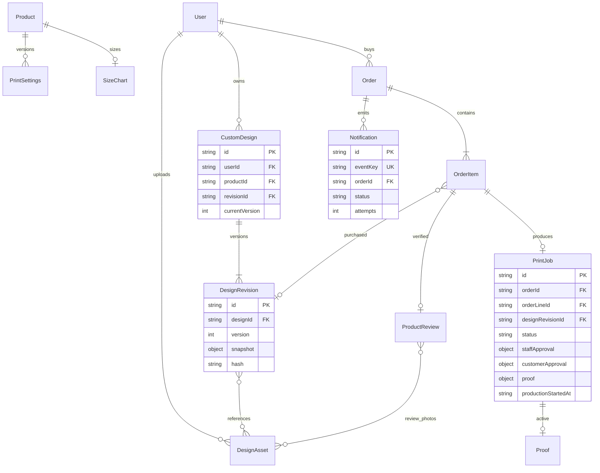

# Quan hệ dữ liệu

> Schema hiện tại là **5**, có thêm `mailOutbox`, `PrintJob.proof.exports/proofHistory` và `PrintSettings.exportDpi`. Chi tiết migration nằm trong [V2 remediation](VELATHIER_V2_REMEDIATION.md); sơ đồ bên dưới thể hiện mô hình nền.

OrderItem và Proof là embedded documents, không phải collection riêng. Snapshot chứa layers, màu/size, settings và asset references. Original file ở private filesystem; hash và kích thước ở DesignAsset. Review photos có purpose=review, không được dùng làm artwork.

Collections mới: `designs`, `designRevisions`, `designAssets`, `printSettings`, `printJobs`, `sizeCharts`, `notifications`. `reviews` đã có trước đợt này; bổ sung photoAssetIds. Order thêm lineId, itemType, designSnapshot, printSettingsSnapshot, priceBreakdown, printJobId, stockConsumed, requestKey/requestHash; refundTransactions chống reference lặp. Product thêm media[]. Không đổi business IDs hoặc bắt migration lại đơn lịch sử.
