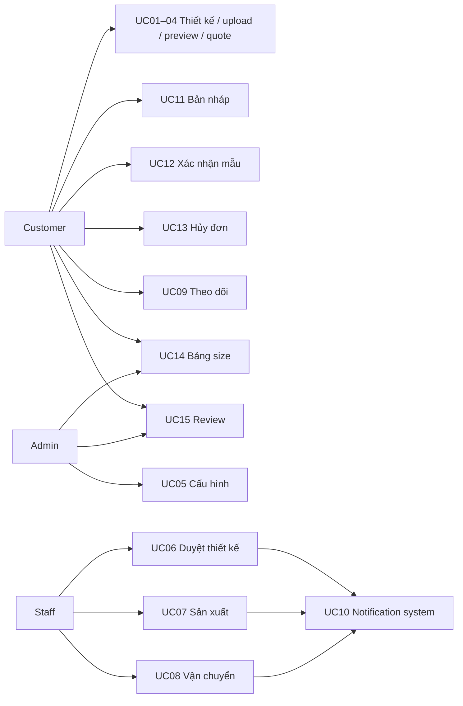
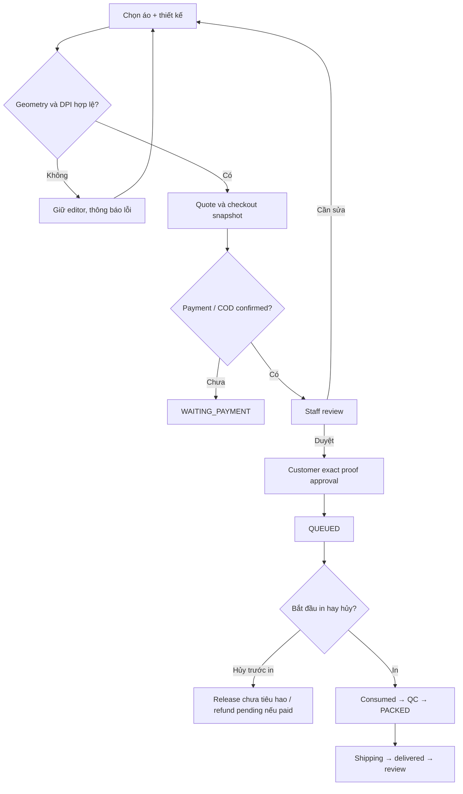

# Đặc tả yêu cầu VELATHIER Custom Printing

Phạm vi: 15 UC trên website hiện có. Actor Customer là tài khoản role=customer; các chức năng thiết kế/proof yêu cầu emailVerified. Staff được xử lý đơn/xưởng; chỉ Admin cấu hình giá, vùng in, gallery, size, moderation và hủy ngoại lệ sau in. Tất cả số tiền là integer VND. Minh họa không cam kết màu in vật lý.

## UC01 — Design Custom Print
- Actor chính Customer; phụ Product/PrintSettings service. Trigger: “Tự thiết kế áo”.
- Tiền điều kiện: product active, variant active, settings enabled, có mockup theo màu. Hết hàng không đặt được.
- Thành công: chọn màu/size → chọn mặt → thêm text/image → kéo/resize/rotate hoặc nhập số → căn giữa/reset/delete → lưu version → báo giá → thêm giỏ.
- Thay thế: đổi mặt giữ layers độc lập; text dùng font và màu curated; chọn variant khác cập nhật mockup; mở draft tiếp tục.
- Ngoại lệ: vùng in không hợp lệ, thiếu ảnh, màu chưa cấu hình, product ngừng bán. Server trả lỗi; nội dung editor không bị xóa.
- Hậu điều kiện: draft revision có geometry normalized, hoặc cart tham chiếu revision bất biến. Không lấy giá từ browser.
- Quy tắc: tối đa 20 layers/mặt; bounding box sau xoay nằm trong zone; cart key bao gồm revision.
- API/entities: POST/PATCH /designs, /orders/quote; CustomDesign, DesignRevision, PrintSettings, OrderItem.
- Chấp nhận: lưu/reload giữ geometry; hai thiết kế cùng SKU không bị gộp; vượt zone bị chặn. API/unit đã tự động kiểm tra; thao tác canvas trực quan cần E2E browser.

## UC02 — Upload Print Image
- Actor chính Customer; phụ Sharp/private storage. Trigger: chọn file trong Studio.
- Tiền điều kiện: authenticated verified Customer, draft thuộc mình, xác nhận quyền sử dụng.
- Thành công: frontend kiểm tra type/size → multipart → decoder server kiểm tra format/pixels → lưu original riêng tư và preview WebP → metadata → thêm layer.
- Thay thế: ảnh 150–299 DPI mặc định cần acknowledgment khi quote; ≥300 được chấp nhận để Staff tiếp tục kiểm tra.
- Ngoại lệ: sai định dạng, executable giả PNG, corrupt, oversized, quá pixel limit, thấp hơn minDpi, mất kết nối, quyền khác user hoặc lỗi ghi file. Không tạo usable asset khi decoder thất bại; rollback hook và GC xử lý file mồ côi.
- Hậu điều kiện: asset có owner, dimensions, hash, reference; không có base64 trong order.
- Quy tắc: tối đa 10MB theo settings, PNG/JPEG/WebP; original không public; Staff chỉ xem asset đã được gán job.
- API/entities: POST /designs/:id/assets; GET /design-assets/:id; DesignAsset.
- Chấp nhận: PNG hợp lệ lưu và đọc được với quyền; giả file/quá lớn/cross-user bị từ chối; DPI tính theo mm đúng limiting axis.

## UC03 — Preview Custom Print
- Actor Customer; phụ Konva. Trigger: đổi mặt, màu hoặc geometry; “Xem trước”.
- Tiền điều kiện: snapshot có settings và mockup đúng màu.
- Thành công: render mockup 4:5 → map vùng in normalized → render ordered layers → đổi mặt/zoom → bỏ guides ở chế độ preview.
- Thay thế: preview immutable trong order/proof cũng dùng DesignCanvas; numeric controls thay drag cho accessibility.
- Ngoại lệ: mockup tải lỗi có loading notice; asset mất trên server bị chặn ở quote/staff approval; không thay bằng ảnh sản phẩm không liên quan.
- Hậu điều kiện: preview biểu diễn đúng dữ liệu revision; chưa phải chứng nhận màu hay bản RIP sản xuất.
- Quy tắc: cùng hệ tọa độ giữa editor và proof; mỗi mặt độc lập; không overlay tùy ý lên ảnh lifestyle.
- API/entities: GET /designs/:id, /orders/:id/print-proofs; DesignRevision.snapshot, PrintJob.proof.
- Chấp nhận: geometry và mockup paths được test; render canvas/desktop/mobile chưa được kiểm chứng bằng browser do host unavailable.

## UC04 — Calculate Custom Print Fee
- Actor chính Customer; phụ pricing service. Trigger: lưu draft, quote và checkout.
- Tiền điều kiện: variant còn bán/còn hàng; revision sở hữu hợp lệ; geometry/DPI đạt.
- Thành công: đọc giá áo/cấu hình hiện tại → phí theo mặt có layer → qty → voucher → shipping → Quote → xác nhận acceptedTotal → lưu priceBreakdown vào order.
- Thay thế: không có lớp cả hai mặt thì phí in 0; kết hợp regular/custom; giá draft được tính lại khi mua.
- Ngoại lệ: phí âm/cấu hình sai, variant inactive, thiếu acknowledgment, giá đổi hoặc zone đổi. Checkout trả 409 cần xác nhận hoặc mở/lưu lại draft.
- Hậu điều kiện: tổng và snapshot do server tính; client price bị bỏ qua.
- Quy tắc: không tăng tổng đơn đã trả khi sửa mẫu. Đổi chargeable sides yêu cầu hủy và đặt lại.
- API/entities: POST /orders/quote, POST /orders; pricing.buildLines, PrintSettings, OrderItem.priceBreakdown.
- Chấp nhận: front 49k/back69k demo, qty/voucher/shipping đúng; snapshot cũ không đổi; retry cùng requestKey không tạo đơn mới.

## UC05 — Manage Custom Print Settings
- Actor Admin; phụ media service. Trigger: Quản trị → Cấu hình in/Size.
- Tiền điều kiện: product tồn tại; role Admin.
- Thành công: chọn sản phẩm → bật/tắt → chọn technique → cấu hình phí/zone/mm/DPI/formats/size → upload hoặc chọn mockup → xem trước → xuất bản version → xem history.
- Thay thế: tắt in không xóa jobs đã mua; chọn sản phẩm mới để thêm cấu hình; gallery có màu/nguồn/license metadata.
- Ngoại lệ: Staff truy cập, version cũ, fee âm, zone vượt ngoài, tỷ lệ mockup/mm không phù hợp, file không tồn tại; server từ chối.
- Hậu điều kiện: version mới áp dụng quotes tương lai; historical snapshots giữ nguyên.
- Quy tắc: không tự bật quần/tất/phụ kiện; admin phải có template phù hợp. Technique dùng một cấu hình active mỗi sản phẩm.
- API/entities: GET/PUT /admin/print-settings, /admin/products/:id/media; PrintSettings/Product.media.
- Chấp nhận: Admin chỉnh được; Staff 403; settings/version append-only và giá đơn cũ giữ nguyên.

## UC06 — Review Custom Print Design
- Actor chính Staff; phụ Customer, notification worker. Trigger: job vào hàng đợi review.
- Tiền điều kiện: paymentReady, reserved stock, WAITING_STAFF_REVIEW và revision hợp lệ.
- Thành công: mở job → xem áo/màu/size/placement/DPI → approve → ghi reviewer/time/revision → tạo proof/hash → WAITING_CUSTOMER_APPROVAL và event.
- Thay thế: revise hoặc reject phải có reason; Customer gửi revision mới quay về review, không xóa phiên bản cũ.
- Ngoại lệ: cancelled, thiếu payment, malformed design, mất original/preview → không duyệt.
- Hậu điều kiện: approval có audit; không tự chạy sản xuất.
- Quy tắc: sửa mẫu reset cả staff/customer gate. Staff không xác nhận thay khách.
- API/entities: POST /admin/print-jobs/:id/review; PrintJob, DesignRevision, Notification.
- Chấp nhận: approve đúng chuyển chờ Customer; chưa payment hoặc sai state bị chặn; reject có reason và history.

## UC07 — Update Print Production Status
- Actor chính Staff; phụ order/inventory service. Trigger: chọn công đoạn kế tiếp trong Xưởng in.
- Tiền điều kiện: job hợp lệ, không hủy; trước PRINTING đủ staffApproval/currentRevision/customer exact proof/payment/reserved.
- Thành công: QUEUED → PRINTING → QUALITY_CHECK → PACKED; mỗi bước lưu actor/time/status và notification.
- Thay thế: QC_FAILED có reason → controlled reprint PRINTING có reason → QC lại. Không tính thêm tiền.
- Ngoại lệ: skip stage, thiếu approval/payment, cancelled, snapshot obsolete → 409/403.
- Hậu điều kiện: lần in đầu ghi productionStartedAt và stockConsumed; packed đủ tất cả jobs mới được giao.
- Quy tắc: status sản xuất tách order processing; không hoàn vật tư đã in về áo bán lại.
- API/entities: POST /admin/print-jobs/:id/status; PrintJob.history, OrderItem.stockConsumed.
- Chấp nhận: thử bỏ qua PACKED/thử in thiếu proof thất bại; progression/QC reprint có audit; race cancel/print chỉ một phía thành công trong một writer.

## UC08 — Update Shipping Information
- Actor Staff; phụ Customer notifications. Trigger: đóng gói xong, nhập/correct vận chuyển.
- Tiền điều kiện: đơn chưa đóng/hủy; mọi custom job PACKED. Bàn giao chỉ từ ready_to_ship trở đi.
- Thành công: carrier/tracking/date/ETA/note → validate → lưu lịch sử → shipped → cập nhật in_transit/delayed/delivery_failed → delivered qua order state API.
- Thay thế: sửa tracking giữ audit; mốc nhập lặp cùng dữ liệu không thêm history.
- Ngoại lệ: thiếu tracking, ngày sai, chưa packed, Customer muốn sửa, mốc trước shipped → từ chối.
- Hậu điều kiện: timeline khách hiển thị đúng thông tin nhập thủ công.
- Quy tắc: không giả live carrier; demo tracking có nhãn DEMO-NOT-LIVE; ghi chú nội bộ không lấy làm ghi chú khách.
- API/entities: PUT /admin/orders/:id/shipping, /status; Order.shipping/history.
- Chấp nhận: guard ready/shipped, retry/correction audit, delivered có lịch sử shipped và tracking hợp lệ.

## UC09 — Track Order & Shipping
- Actor Customer; phụ Staff/Admin có quyền xem. Trigger: mở chi tiết đơn.
- Tiền điều kiện: authenticated; own order hoặc quyền Staff.
- Thành công: xem items/giá/phí in/payment → preview và lịch sử duyệt/sản xuất → carrier/tracking/shipping → refund/cancel.
- Thay thế: waiting payment, revision required, QC failed, delayed, cancelled hoặc refund pending đều có nhãn/trạng thái riêng.
- Ngoại lệ: đơn người khác trả 404; mạng lỗi có trạng thái lỗi/làm mới.
- Hậu điều kiện: người dùng hiểu bước tiếp theo, có nút approve/revise đúng state.
- Quy tắc: timeline in và order tách riêng để tránh nhầm lifecycle; chỉ history visibleToCustomer, không trả refundTransactions nội bộ.
- API/entities: GET /orders/:id, /orders/:id/print-proofs; Order, PrintJob.
- Chấp nhận: owner đọc được, stranger không; các mốc lifecycle có dữ liệu persist; refresh route phục vụ SPA.

## UC10 — Send Order Notification Email
- Actor chính System; phụ SMTP hoặc development outbox. Trigger: event đơn/in/payment/shipping/refund.
- Tiền điều kiện: event đã lưu trong notifications với eventKey unique và recipient từ order.
- Thành công: worker chọn pending/failed đủ thời gian → template Vietnamese escaped + protected order link → gửi → lưu mode/status/attempt/time.
- Thay thế: không SMTP dùng outbox; lỗi gửi retry tối đa 3, không ghi thành công giả.
- Ngoại lệ: SMTP lỗi, process chết, thiếu recipient; giữ failed và theo dõi. Có cửa sổ duplicate khi SMTP ACK rồi DB chưa commit.
- Hậu điều kiện: evidence sent/failed được lưu; API retry không tạo event thứ hai.
- Quy tắc: không đưa original artwork/OTP vào email custom; template OTP cũ giữ bảo vệ hiện có.
- API/entities: worker nội bộ, Admin Email UI; Notification, Email.
- Chấp nhận: dedupe eventKey và outbox tự động test; SMTP live/failure provider chưa chạy trong môi trường này.

## UC11 — Save & Continue Custom Design
- Actor Customer; phụ versioning service. Trigger: Lưu bản nháp/debounced autosave/mở Thiết kế của tôi.
- Tiền điều kiện: verified owner; product/settings còn hợp lệ.
- Thành công: lưu title/variant/layers → new revision → danh sách với timestamp/version → reopen → tiếp tục sửa.
- Thay thế: autosave sau 1,8 giây trên draft đã tạo; local session recovery lưu nội dung chưa đồng bộ; xóa draft chưa dùng sau confirm.
- Ngoại lệ: conflict tab cũ, expired auth, mất mạng, product ngừng bán/asset mất. Không xóa editor; báo lỗi và có thể khôi phục session.
- Hậu điều kiện: dữ liệu đã lưu có version mới; submitted revision không bị mutation.
- Quy tắc: soft delete chỉ unused draft; revision gắn đơn giữ để audit. Tài khoản khác không đọc được.
- API/entities: GET/POST/PATCH/DELETE /designs; CustomDesign/DesignRevision.
- Chấp nhận: geometry reload và version conflict test; không ghi đè tab mới; UI autosave/recovery cần browser E2E thủ công.

## UC12 — Approve Final Print Proof
- Actor Customer; phụ Staff/notification. Trigger: job WAITING_CUSTOMER_APPROVAL.
- Tiền điều kiện: Staff approval active, proof chứa exact snapshot/hash, payment hợp lệ.
- Thành công: xem hai mặt/màu/size/placement → acknowledgment → gửi proofId/hash → persist Customer/time/revision/hash → QUEUED.
- Thay thế: request revision có lý do → REVISION_REQUIRED; gửi corrected revision → staff review lại.
- Ngoại lệ: old proof, wrong owner/role, cancelled, no acknowledgment → từ chối; duplicate same approval idempotent.
- Hậu điều kiện: sản xuất có thể bắt đầu với gate đủ; bản proof cũ không còn quyền duyệt sau sửa.
- Quy tắc: Staff không được dùng API để đóng vai Customer; sau in không dùng revision workflow thường.
- API/entities: /print-jobs/:id/approve, /revision; PrintJob.proof/customerApproval.
- Chấp nhận: exact/obsolete/repeated approval và invalidation được test; preview là dữ liệu snapshot immutable, chưa phải PDF ký số.

## UC13 — Cancel Custom Print Order
- Actor Customer; phụ Admin ngoại lệ, inventory/payment service. Trigger: Hủy đơn + reason.
- Tiền điều kiện: own order, trước bàn giao, không job nào productionStartedAt cho Customer.
- Thành công: recheck → cancel order/jobs → trả kho chưa tiêu hao một lần → restore voucher một lần → nếu paid refund_pending → event.
- Thay thế: QUEUED vẫn hủy; Admin sau in cần disposition rõ ràng; late VNPay callback ghi paid nhưng giữ jobs cancelled và chờ refund.
- Ngoại lệ: race start printing, stranger, delivered, thiếu reason/disposition, refund provider lỗi → không bypass/không báo đã hoàn giả.
- Hậu điều kiện: audit, tồn kho/voucher/payment nhất quán trong giới hạn single-writer UOW.
- Quy tắc: hủy toàn đơn; không partial line cancellation; consumed stock không restock; refund không vượt collected remaining.
- API/entities: POST /orders/:id/cancel, refund API cũ; Order, PrintJob, inventory, voucher, refundTransactions.
- Chấp nhận: before/after print, duplicate release, paid cancel, late callback và cancel/print race được test.

## UC14 — Size Guide & Fit Recommendation
- Actor Customer; phụ Admin quản lý chart. Trigger: mở Bảng size/gợi ý trên product.
- Tiền điều kiện: có SizeChart cho áo; nếu không có không bịa gợi ý.
- Thành công: xem số đo áo cm/phom → nhập vòng ngực cơ thể và độ rộng → tính ease → chọn row phù hợp nhỏ nhất → kiểm tra màu/stock → giải thích.
- Thay thế: hết stock vẫn giải thích size phù hợp nhưng available=false; ngoài chart thì báo chưa có size; Admin cập nhật chart có version.
- Ngoại lệ: số đo không hợp lệ, chart không tồn tại, size duplicate hoặc update version cũ → lỗi rõ ràng.
- Hậu điều kiện: gợi ý ước tính, không lưu body measurements.
- Quy tắc: dữ liệu demo có sample label; không gọi là AI fitting; hiện triển khai cho tops/hoodie, không bịa waist/hip cho quần chưa có chart.
- API/entities: /products/:id/size-guide, /size-recommendation, /admin/size-charts/:id; SizeChart/Variant.
- Chấp nhận: thresholds/stock kiểm tra API; UI có bảng và giải thích không cam kết vừa tuyệt đối.

## UC15 — Rate & Review Product
- Actor Customer; phụ Admin moderation và khách đọc public. Trigger: đơn delivered, chọn lần mua trong review panel.
- Tiền điều kiện: role Customer sở hữu đúng order line, chưa có review khác cho line.
- Thành công: 1–5 sao + text + tối đa 4 ảnh tùy chọn → server kiểm tra delivered/ownership → published review → aggregate/distribution và Verified Purchase.
- Thay thế: sửa review của mình; cùng khách được review ở đơn khác; sort newest/rating; Admin hide/publish với reason/history.
- Ngoại lệ: chưa delivered, rating sai, duplicate, user khác, ảnh giả/oversized → từ chối; ảnh hidden review không public.
- Hậu điều kiện: review có purchase relation, statistics tính từ published; không phạt nhận xét tiêu cực.
- Quy tắc: review photo tách artwork; chỉ derived WebP được public; Staff không giả verified buyer.
- API/entities: review endpoints, /review-photos, /admin/reviews; ProductReview, OrderItem, DesignAsset(purpose=review).
- Chấp nhận: suite reviews cũ + custom review/photo/moderation integration đạt; UI vẫn cần browser smoke test cuối.

## Activity: submit/review/print

